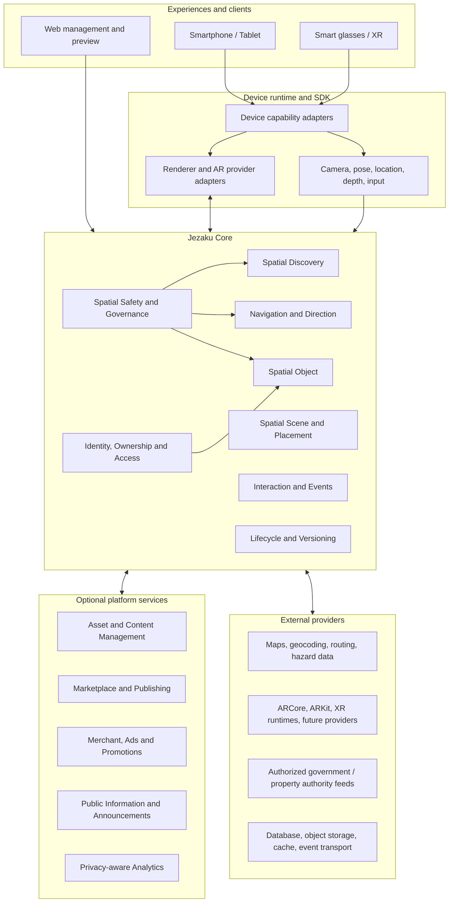

# Jezaku Product, Architecture, and Engineering Guidance

> **Status:** Strategic architecture and engineering guidance. This document describes the agreed product direction and target architecture. It does not claim that every capability below is implemented. Existing source code, tests, API contracts, and scoped agent instructions remain authoritative for current behavior.

This file applies to product and cross-cutting architecture work documented under `docs/`. Repository-wide rules remain in the root `AGENTS.md`; backend and UI implementation rules remain in `Backend/AGENTS.md` and `UI/AGENTS.md`.

## 1. Product vision

Jezaku is an **extensible spatial experience platform** that connects digital content, information, services, and interactions to physical places and environments through augmented reality and other spatial interfaces.

Jezaku should support many domains without embedding any one domain's business rules into the spatial core:

- Personal memories, frames, wall art, and decorations.
- Education, museums, tourism, and public information.
- Commercial experiences, merchants, stores, tenant directories, promotions, and advertising.
- Public services, announcements, landmarks, and civic information.
- Navigation, wayfinding, accessibility guidance, and directional experiences.
- Industrial assistance, maintenance, training, and operational overlays.
- Games, social experiences, events, and persistent shared digital spaces.
- Specialized experiences such as Qibla direction.

The physical world remains authoritative. Jezaku adds a digital layer; it must not physically alter, damage, obstruct, or claim control over real objects or spaces. Digital placement must respect real-world safety, ownership, law, consent, and public authority.

### 1.1 Product positioning

Think of Jezaku as a platform for **creating, publishing, discovering, governing, and experiencing digital content in physical space**—not merely an AR camera, photo app, advertising network, or navigation app.

### 1.2 Product layers

1. **Jezaku Core:** spatial domain model, object/scene lifecycle, placement abstractions, discovery, interaction contracts, device capability contracts, identity/access integration, and safety policy enforcement interfaces.
2. **Jezaku Platform:** optional platform services such as asset management, publishing, marketplace, merchant/tenant management, campaigns, analytics, moderation, and developer tooling.
3. **Jezaku Experiences:** domain-specific applications and extensions such as Qibla, tourism, education, commerce, public services, games, and industrial assistance.

Core must remain useful without marketplace, advertising, merchant, or any other optional commercial service being installed.

## 2. Non-negotiable design principles

1. **Spatial-first, domain-agnostic:** model reusable spatial primitives and capabilities. Keep domain-specific workflows in experiences or extensions.
2. **Safety before engagement:** no advertisement, object, route, game, or interaction may override a safety restriction.
3. **Physical-world respect:** never require or encourage users to damage, modify, trespass, obstruct, or interfere with physical property or public infrastructure.
4. **Device-agnostic:** smartphone-first, but do not couple domain models or APIs to one AR SDK, operating system, headset, or glasses vendor.
5. **Separate truth from presentation:** coordinates, ownership, permissions, routes, and object identity are domain data; arrows, labels, models, animations, and HUDs are presentations.
6. **Server-authoritative governance:** backend authorization, visibility, moderation, authority restrictions, and campaign eligibility are authoritative. Client checks are defense-in-depth and responsiveness aids.
7. **Fail safely:** if critical safety state, permissions, localization quality, or policy validity cannot be established, suppress or degrade the affected spatial experience rather than guessing.
8. **Privacy by design:** location, camera, sensor, identity, movement, and social data are sensitive. Minimize collection, precision, retention, logging, and sharing.
9. **Extensible, not arbitrary:** extensions use versioned contracts, explicit capabilities, declared permissions, resource budgets, validation, and sandboxing.
10. **Interoperable and evolvable:** stable API schemas, versioned events, migrations, documented compatibility, and provider adapters.
11. **Accessible and understandable:** offer non-AR alternatives, clear labels, accessible interaction, localization, and warnings that do not depend on color alone.
12. **Evidence-based claims:** never describe proposed functionality as implemented. Record real device and field validation separately from simulator or unit-test results.

## 3. Scope and repository guidance

Before implementing a proposal:

- Inspect the relevant current module, tests, configuration, OpenAPI contracts, migrations, and scoped `AGENTS.md`.
- Use existing module ownership where possible. Do not create a service merely because a conceptual box appears in a diagram.
- The current repository includes a Flutter UI and a Maven multi-module Quarkus backend. Preserve the established stack and module conventions unless a deliberate decision is recorded.
- Existing geotagged memories/frames and their visibility/radius rules remain valid product behavior. Do not silently weaken them while generalizing the platform.
- Current docs such as `architecture.md`, `geospatial-placement.md`, `local-data-and-discovery.md`, and device validation notes describe existing or earlier implementation context. Keep current behavior distinct from the target architecture in this document.
- Update relevant docs, tests, API contracts, and migration notes in the same change as implementation changes.
- Prefer additive and backward-compatible evolution. If a breaking change is needed, document migration and compatibility strategy first.

## 4. Target conceptual architecture

The following is a target capability map, not a mandate to split every box into a separate deployable service.



### 4.1 Logical module responsibilities

Keep these as logical boundaries first; map them to existing modules only after inspecting code ownership and deployment needs.

| Capability | Responsibility |
|---|---|
| Spatial Object | Identity, type, definition, metadata, owner, tenant, lifecycle |
| Spatial Scene | Grouping, composition, relationships, scene state |
| Placement and Anchors | Geographic, surface, world, relative, session, and user-relative placement |
| Spatial Discovery | Find eligible content by location, view direction, context, permissions, and device capability |
| Spatial Interaction | Tap, gaze, gesture, voice, proximity, accessibility and event contracts |
| Navigation | Targets, routes, waypoints, direction and presentation-independent instructions |
| Safety and Governance | Geofences, hazard policies, authority restrictions, risk decisions, enforcement and audit |
| Identity and Access | User, organization, tenant, owner, role, grants, visibility and policy integration |
| Asset Management | Validated media, models, textures, animations, audio and optimization variants |
| Publishing and Marketplace | Package validation, versions, review, distribution, licensing and revocation |
| Commerce | Merchants, campaigns, promotions, eligibility, redemption and billing integrations |
| Device Runtime | Sensor abstraction, tracking quality, renderer and platform adapters |

Do not introduce duplicate identity, location, moderation, or event abstractions if an existing module already owns them. Extend the existing owner through explicit contracts.

## 5. Spatial domain model

### 5.1 Spatial Object

A Spatial Object is a digital entity that may be placed, discovered, rendered, interacted with, governed, and versioned in a spatial context. It need not be a 3D model; it may be a 2D panel, marker, audio cue, text, route instruction, media item, or interactive experience.

Conceptual fields:

```text
SpatialObject
  id
  tenantId
  owner: USER | MERCHANT | ORGANIZATION | PLATFORM
  type
  category
  definition
  appearance
  placement
  interaction
  visibility
  accessPolicy
  capabilities[]
  lifecycle
  safetyClassification
  metadata
  version
```

Keep typed, validated domain fields for core semantics. Use extension metadata only for genuinely extension-specific properties; do not hide required authorization or safety fields in arbitrary JSON.

### 5.2 Placement strategies

Support these as placement strategies where technically valid:

- `GEO_ANCHORED`: geographic coordinates and optional altitude.
- `WORLD_ANCHORED`: a spatial anchor in a localized physical environment.
- `SURFACE_ANCHORED`: detected wall, floor, table, or other supported surface.
- `RELATIVE_ANCHORED`: positioned relative to another object or anchor.
- `CAMERA_RELATIVE`: transient presentation relative to the camera; not a substitute for world placement.
- `USER_ATTACHED`: attached to the user's view or device where the experience explicitly warrants it.
- `SESSION_ANCHORED`: exists for a bounded session.

Each placement must declare its coordinate frame, units, orientation convention, tracking requirements, accuracy/confidence, persistence, and fallback behavior. A placement must never imply that the digital object is physically attached to or alters a real object.

### 5.3 Spatial Scene

A scene groups objects and relationships into a coherent experience. It may define ordering, visibility, transitions, interaction state, and a bounded activation context. Scene composition must not bypass object-level permissions or safety policy.

### 5.4 Object lifecycle

Use explicit lifecycle transitions, for example:

`DRAFT -> VALIDATING -> PENDING_REVIEW -> PUBLISHED -> ACTIVE -> SUSPENDED -> EXPIRED / REVOKED / DELETED`

Not every object requires every state. Record who/what caused privileged transitions and why. Revocation and emergency suspension must propagate to discovery, caches, clients, and marketplace distribution.

### 5.5 Ownership and visibility

Ownership, publishing authority, and viewing permission are distinct concepts. Visibility may include `PUBLIC`, `PRIVATE`, `FRIENDS`, `TENANT`, and `RESTRICTED`, but each must resolve through a server-side policy. Tenant scope is not a substitute for user authorization. Preserve existing frame rules: owners may access their own gallery content according to product rules; other viewers must satisfy sharing and on-site radius policy. Do not enable remote browsing of another person's frame unless an explicit product decision changes that rule.

## 6. Spatial discovery

Discovery determines which content is eligible to be presented—not merely which content is geographically nearby.

Evaluate at least:

- Geographic proximity and location accuracy.
- View direction and camera field of view, when relevant.
- Placement and tracking validity.
- Visibility, ownership, blocks, tenant, and access policy.
- Object lifecycle and moderation status.
- Safety/geofence decision.
- User preferences and consent (especially advertising).
- Device capabilities and experience compatibility.
- Frequency caps, ranking, and relevance where applicable.

Use spatial indexes (for example PostGIS) and bounded queries. Avoid returning all nearby content. Use pagination, result limits, cache expiry, and server-side filtering. Client-side filtering is never the privacy or safety boundary.

## 7. Spatial Safety and Governance Engine

**Safety and Governance is a core cross-cutting capability.** It must be designed before public publishing, navigation, commercial targeting, or open marketplace distribution.

Jezaku may add digital content to a user's view, but it must not encourage unsafe movement, trespass, obstruction, distraction, or entry into prohibited areas.

### 7.1 Safety objectives

- Prevent or suppress spatial content in prohibited or hazardous locations.
- Prevent unsafe route guidance and unsafe arrival instructions.
- Allow authorized local authorities and property controllers to define, update, and revoke restrictions within their legitimate jurisdiction.
- Apply emergency restrictions quickly and consistently.
- Protect users, bystanders, property, public infrastructure, and sensitive locations.
- Make restrictions explainable, auditable, time-bounded where appropriate, and resistant to tampering.
- Never imply that a Jezaku safety check guarantees that a location is safe.

### 7.2 Geofence and hazard policy

Support polygons, multipolygons, circles, corridors, route segments, vertical bounds where available, and time windows. Policies may represent:

- Roads, carriageways, medians, rail corridors, runways, waterways, and other movement hazards.
- Cliffs, steep slopes, unstable terrain, avalanche/flood/fire zones, construction sites, and other environmental hazards.
- Private property, restricted facilities, critical infrastructure, and no-entry areas.
- Schools, hospitals, places of worship, memorials, or other sensitive zones where local rules or user protections require special handling.
- Temporary event perimeters, emergency scenes, evacuation zones, and temporary closures.
- Areas where camera use, recording, advertising, or specific content categories are prohibited.

A geographic polygon alone may not adequately represent a hazard. Where possible, combine authoritative geospatial data, routing constraints, property boundaries, device context, and field reports. Treat uncertain or stale hazard data conservatively.

### 7.3 Policy outcomes

Use explicit outcomes, with room for additional policy dimensions:

| Outcome | Required behavior |
|---|---|
| `ALLOWED` | Experience may proceed subject to all other policies |
| `CAUTION` | Show clear warning; apply required interaction/rendering constraints |
| `RESTRICTED` | Only explicitly authorized content or actions may proceed |
| `PROHIBITED` | Do not publish, discover, render, or route users into the prohibited use |
| `EMERGENCY_LOCKDOWN` | Immediately suspend affected experiences and apply emergency behavior |

A restriction may target a content category, activity, audience, device mode, route, time period, or all spatial content. Define the scope precisely.

### 7.4 Policy precedence

Safety policy must be evaluated before discovery ranking, advertising selection, rendering, or route presentation.

Recommended precedence:

1. Applicable law and authenticated emergency orders.
2. Authorized government/local authority restrictions within verified jurisdiction.
3. Property owner/controller restrictions within verified property authority.
4. Platform-wide safety rules and protected-area policy.
5. Tenant/organization policy.
6. Experience, merchant, creator, and user preferences.

Higher-priority policy wins. Lower-priority actors cannot override higher-priority restrictions. Resolve conflicts by suppressing the affected experience until authoritative clarification; do not silently select the least restrictive rule.

The platform must verify the issuing principal, role, jurisdiction, scope, validity, and provenance of authority instructions. Do not accept an unverified claim that someone represents a local authority.

### 7.5 Restriction lifecycle and authority controls

A restriction record should include:

- Stable ID and version.
- Geometry and coordinate reference system.
- Jurisdiction and affected area.
- Restriction type, severity, and affected activities/content.
- Issuing authority and authenticated principal.
- Legal/administrative basis or reference where provided.
- Effective-from and expiry times; explicit indefinite status only when justified.
- Source/provenance, creation time, last update, and revocation.
- Priority and supersession relationship.
- Review/appeal metadata where applicable.
- Audit trail of every privileged action.

Provide authority-facing APIs and operational tools for create, validate, activate, update, expire, revoke, bulk import, and emergency suspension. Support signed or otherwise authenticated feeds where available. Keep a human-reviewed fallback for data sources that cannot be authenticated automatically.

Emergency controls need a fast activation path, but must still be authenticated, logged, scoped, and reviewed after activation. Provide rollback and correction procedures for erroneous restrictions.

### 7.6 Safety evaluation contract

Every relevant operation should be able to request a policy decision, conceptually:

```text
SafetyDecisionRequest
  subjectId / tenantId
  activity: DISCOVER | PUBLISH | RENDER | NAVIGATE | REDEEM | INTERACT
  objectId / experienceId (optional)
  origin and destination (when applicable)
  currentLocation + accuracy + timestamp (when consented/available)
  route geometry (when applicable)
  device and tracking capabilities
  requested time window

SafetyDecision
  outcome
  applicablePolicyIds[]
  reasonCodes[]
  allowedCapabilities[]
  deniedCapabilities[]
  warnings[]
  validUntil
  policyVersion
  reevaluationRequired
```

This is a conceptual contract, not an existing endpoint. Design it as a reusable application/domain boundary with consistent semantics across backend and client. Avoid returning sensitive authority or security details to unauthorized callers.

### 7.7 Enforcement points

- **Publish:** reject or hold content whose placement or use violates active policy.
- **Discovery:** exclude prohibited or unauthorized content before returning it.
- **Render:** client rechecks cached policy and local context; hide or disable affected content immediately when a restriction is known.
- **Navigation:** validate origin, destination, route geometry, waypoints, and route updates. Do not direct a user into a prohibited or hazardous area.
- **Advertising:** apply safety, consent, location, and frequency rules before selecting an ad.
- **Marketplace:** suspend, unpublish, or revoke packages and placements that violate policy.
- **Offline mode:** honor unexpired cached restrictions; if critical policy is missing, stale, or unverifiable, suppress high-risk actions and show a clear unavailable/safety status. Never assume that lack of a known restriction means an area is safe.

### 7.8 Client and user safety

- Do not encourage users to look at a screen while crossing roads, driving, cycling, operating machinery, climbing, or navigating hazardous terrain.
- Provide a clear pause/exit behavior and encourage users to stop in a safe place before interacting.
- Consider motion/activity signals only with appropriate permissions and privacy controls; do not treat them as perfectly reliable.
- Reduce or disable camera overlays and interactive controls when the user appears to be moving in a high-risk context, where the platform can reasonably detect it.
- Never place a critical warning solely behind a tap or in a small, peripheral, low-contrast overlay.
- Provide audio/haptic or non-AR alternatives only where they are safe and accessible.
- Display localization/tracking confidence. If position, heading, altitude, or anchor confidence is insufficient for a safety-critical experience, do not present precise-looking guidance.
- Provide reporting and correction flows for dangerous or misplaced content.
- Safety disclaimers supplement engineering controls; they do not replace them.

## 8. Navigation and direction

Navigation is a domain capability independent of its visual representation.

### 8.1 Domain concepts

- `NavigationTarget`: destination identity, coordinates, category, owner/tenant, access, hours/availability, and metadata.
- `NavigationRoute`: ordered route geometry, segments, waypoints, instructions, mode, provider, and validity.
- `NavigationInstruction`: semantic action and distance/condition, independent of arrow artwork.
- `NavigationPresentation`: arrow, path, marker, landmark, voice, haptic, map, or glasses-specific rendering.
- `NavigationPolicy`: access, safety, route mode, time, and user constraints.

A target is not an arrow. The same target/instruction may be rendered as an AR arrow on a phone, a 2D map marker, voice guidance, or a compatible glasses overlay.

### 8.2 Navigation safety requirements

Validate route geometry and each meaningful route update against active restrictions. Check both destination and the path—not only the endpoint. Respect road/path access, pedestrian/cyclist/vehicle modes, closures, private property, accessibility requirements, and provider confidence. If route validation fails, do not draw a misleading arrow toward the unsafe route; offer a safe alternative or explain that guidance is unavailable.

Do not use raw straight-line bearing as a substitute for a navigable route. A direct bearing may be appropriate for non-route direction experiences such as Qibla, but must be clearly distinguished from walkable/drivable navigation.

### 8.3 Qibla experience

Qibla is a specialized direction experience built on geographic position, bearing calculation, device orientation, and a presentation adapter. It is not ordinary road routing. Provide a conventional compass/non-AR fallback, calibration guidance, sensor confidence, and clear indication of accuracy limitations. Validate the geodesic bearing implementation with known test vectors and independent references.

### 8.4 Target API shape

Any future target API should support tenant/owner, public/private/restricted visibility, coordinates and coordinate accuracy, category, destination metadata, availability, schedule, presentation preference, access policy, and lifecycle. API examples must be labeled illustrative until implemented and published in OpenAPI.

## 9. Spatial commerce and proximity advertising

Commerce is an optional platform capability built on spatial objects, discovery, identity, consent, and safety—not a special case embedded in the renderer.

### 9.1 Merchant and campaign model

Separate merchant/store identity, spatial placement, campaign, creative object, promotion, eligibility, and redemption.

A promotion may define discount/benefit, start/end, quota, eligibility, arrival window, redemption conditions, and authoritative status. Distinguish campaign expiry, user's eligibility window, arrival deadline, and redemption expiry.

### 9.2 Proximity advertising behavior

A spatial advertisement may be eligible based on location, distance, direction/field of view, campaign schedule, audience rules, user consent, frequency caps, merchant availability, and safety policy. Nearby does not automatically mean relevant or permitted.

- Proximity advertising must be opt-in where required and controlled through clear preferences.
- Do not continuously collect or retain precise location solely for ad targeting without valid consent and a clear purpose.
- Respect sensitive places and local restrictions; default to no advertising where policy or location classification is uncertain.
- Label paid/promoted content clearly.
- Apply frequency caps and prevent repeated intrusive overlays.
- Do not obscure hazards, public warnings, navigation cues, or emergency information.
- Do not imply a discount is guaranteed until eligibility and availability are verified.
- Use server-authoritative campaign time and redemption validation. A client countdown is display-only and must not be trusted for redemption.
- Merchant identity and offer terms must be verifiable and reportable.

## 10. Marketplace and extension ecosystem

The marketplace should support more than downloadable 3D assets.

### 10.1 Marketplace categories

- **Asset marketplace:** GLB/glTF, USDZ where supported, textures, materials, animation, audio, icons, optimized variants.
- **Object marketplace:** reusable frames, panels, signs, markers, arrows, interactive displays, and object definitions.
- **Template marketplace:** scene layouts, wall arrangements, store displays, and reusable compositions.
- **Experience marketplace:** complete educational, tourism, event, game, public-service, or commercial experiences.
- **Extension marketplace:** trusted integrations, capabilities, provider adapters, and developer tools.

A model asset is not itself an interactive experience. Keep asset, object definition, extension package, and experience package distinct.

### 10.2 Extension contract

An extension should declare:

- Unique publisher-scoped identifier, name, version, and license.
- Jezaku API/SDK compatibility range.
- Object types, capabilities, and entry points.
- Required permissions and optional permissions.
- Assets, resource budgets, supported devices, and dependencies.
- Network/data access requirements.
- Safety classification and allowed use contexts.
- Signature, provenance, and integrity metadata.

Extensions must be validated and versioned. Treat packages and content as untrusted input. Use sandboxed execution or constrained declarative behavior; never load arbitrary untrusted native code into the core process. Apply content-type allowlists, size limits, malware scanning where appropriate, provenance checks, capability permissions, rate limits, and revocation.

### 10.3 Developer guidance

Provide versioned SDKs and APIs for:

- Spatial Object and Scene authoring.
- Placement and anchor management.
- Interaction and event subscriptions.
- Navigation targets and presentation.
- Safety policy evaluation and restriction status.
- Asset upload, validation, and publishing.
- Identity, tenant, and access integration.
- Marketplace distribution and lifecycle.

Extensions cannot bypass core safety, identity, privacy, moderation, or platform policy. A declared capability is not an authorization grant.

## 11. Device and rendering architecture

Jezaku is **smartphone-first, not smartphone-only**.

Use device capability discovery rather than hardcoding assumptions about a device family. Capabilities may include camera, location, orientation, visual tracking, geospatial tracking, depth, display, audio, haptics, gaze, gesture, and input modalities.

### 11.1 Provider adapters

Keep platform APIs behind adapters. Initial implementations may use the current Flutter/native AR integration and supported Android/iOS capabilities. Future adapters may target compatible smart glasses and XR devices. Do not promise a vendor capability until verified against the actual device SDK and hardware.

### 11.2 Rendering independence

Domain APIs must not expose ARCore/ARKit-specific classes. A renderer consumes a validated presentation model and device capabilities. Rendering failure must not corrupt domain state. Support graceful degradation to map/list/text/audio where appropriate.

### 11.3 Tracking and accuracy

Represent horizontal, vertical, heading, and anchor confidence separately, with timestamp and source. Do not assume GPS/compass projection is precise. Distinguish approximate projection from native geospatial or visual localization. Never present a high-confidence visual cue when underlying accuracy is low.

## 12. Security, privacy, and governance

- Enforce authorization server-side on every read, write, search, feed, and derived projection.
- Treat precise location, camera media, sensor data, movement history, identity, and social relationships as sensitive.
- Collect only what is needed for the active feature; request permissions just in time and explain why.
- Avoid precise coordinates in ordinary logs, analytics, error messages, and support exports.
- Define retention and deletion for raw location, sensor samples, anchors, media, and derived location data.
- Secure authority and property-owner accounts with strong authentication, scoped roles, jurisdiction/ownership verification, and audit trails.
- Protect APIs against enumeration, scraping, spoofed coordinates, replay, fraudulent merchant campaigns, and mass publication.
- Sign or authenticate privileged policy feeds and extension packages.
- Keep safety-policy changes auditable and tamper-evident where practical.
- Provide reporting, appeals/corrections, and moderation workflows.
- Follow applicable privacy, consumer, advertising, accessibility, property, and geospatial laws in each deployment jurisdiction. Legal review is required for authority integrations and commercial targeting.

## 13. API and event design guidance

Use stable, versioned REST/OpenAPI contracts for synchronous operations and versioned events for asynchronous workflows. The following are conceptual resource families, not existing endpoints:

- `/spatial/objects`, `/spatial/scenes`, `/spatial/placements`
- `/spatial/discovery`
- `/spatial/navigation/targets`, `/spatial/navigation/routes`
- `/spatial/safety/evaluate`, `/spatial/safety/restrictions`
- `/spatial/assets`, `/spatial/extensions`, `/marketplace/*`
- `/commerce/merchants`, `/commerce/campaigns`, `/commerce/promotions`, `/commerce/redemptions`

API rules:

- Validate coordinates, coordinate reference systems, geometry validity, altitude units, heading conventions, time zones, payload sizes, identifiers, and pagination.
- Use idempotency for creation, redemption, authority imports, and retryable state transitions.
- Include policy version/decision validity where a client needs to cache a decision.
- Return actionable reason codes without leaking restricted data.
- Use optimistic concurrency or explicit versions for updates.
- Keep public DTOs separate from persistence entities.
- Document authentication, authorization, visibility, safety behavior, caching, errors, and deprecation.
- Never allow clients to self-assert authority, tenant ownership, merchant verification, campaign eligibility, or redemption success.

## 14. Data and infrastructure guidance

Use the established persistence and infrastructure choices unless measured requirements justify change. PostgreSQL/PostGIS is a natural fit for geospatial queries where already adopted. Use object storage for binary assets, bounded caches for nearby discovery, and an event transport only where asynchronous decoupling is useful.

Geospatial data needs explicit coordinate reference systems and units. Use spatial indexes and geometry validity checks. Avoid storing unnecessary movement trails. Keep authoritative restrictions versioned and cacheable with clear expiry/invalidation. Critical restriction updates must invalidate or supersede stale cached policy promptly.

Do not add Kafka, Redis, a vector database, Kubernetes, or a new microservice solely because it appears in a conceptual diagram. Choose infrastructure based on actual scale, operational capability, and product requirements.

## 15. Testing and validation

### 15.1 Domain and policy tests

Test:

- Spatial object lifecycle and version transitions.
- Placement coordinate transforms and unit conventions.
- Visibility, owner, tenant, sharing, and radius policy.
- Geofence containment, boundaries, holes, altitude/time ranges, and geometry validity.
- Policy precedence, overlapping restrictions, expiry, revocation, and emergency lockdown.
- Authority authentication, jurisdiction checks, audit events, and unauthorized attempts.
- Navigation route intersection with restricted/hazard geometry.
- Stale/offline policy behavior and safe failure.
- Advertising consent, sensitive-zone suppression, frequency caps, eligibility, and redemption race conditions.
- Extension permission enforcement, compatibility, package validation, and revocation.

### 15.2 Client and device tests

Test permission denial, location disabled, low GPS accuracy, compass interference, tracking loss, camera interruption, network loss, stale restriction cache, device movement, screen lock, and transitions between AR and non-AR modes.

### 15.3 Field validation

Simulator tests do not prove real-world spatial accuracy or safety. Maintain a device/field validation matrix for supported phones and future glasses. Validate in controlled, lawful, safe test environments—not in active roads, restricted sites, cliffs, or other hazardous locations. Record device, OS, provider, weather/lighting where relevant, accuracy, tracking state, observed drift, and test limitations.

### 15.4 Safety acceptance criteria

A release involving public spatial content or navigation must demonstrate:

- Prohibited content is not returned/rendered when a valid restriction applies.
- An emergency restriction reaches enforcement points within a defined, measured service objective.
- Stale or unavailable critical policy does not silently allow high-risk navigation or publication.
- Route geometry is checked, not just destination coordinates.
- Warnings are understandable and accessible.
- Users can exit/pause AR without losing essential non-AR access.
- Authority actions are authenticated and audited.
- No test requires unsafe behavior by a participant.

## 16. Suggested delivery roadmap

This is a proposed sequencing guide. Reassess against the actual codebase and dependencies before turning phases into implementation tickets.

1. **Foundation and consolidation:** document current capabilities, stabilize shared spatial vocabulary, object/scene/placement contracts, lifecycle, device capability interfaces, and API compatibility.
2. **Safety and governance foundation:** restriction model, geofence evaluation, policy precedence, authority identity/verification, audit, cache invalidation, client enforcement contract, and safety tests. This must precede open public publishing and commercial discovery.
3. **Spatial navigation and direction:** targets, route abstractions, safe route validation, arrow/map/voice presentations, and Qibla as a separate bearing-based experience.
4. **Content and extension ecosystem:** asset pipeline, declarative object definitions, extension manifest, permissions, package validation, publishing, versioning, moderation, and developer documentation.
5. **Spatial commerce:** merchant/tenant management, consent-aware proximity discovery, campaigns, promotions, countdown display, authoritative eligibility and redemption.
6. **Marketplace:** asset/object/template/experience/extension listings, licensing, creator publishing, review, ratings, monetization, and revocation.
7. **Advanced spatial ecosystem:** glasses/XR adapters, persistent shared spaces, multiplayer, AI-assisted authoring, smart-city, education, and industrial integrations.

Do not delay safety work until after marketplace or advertising. A minimal enforceable safety layer is a prerequisite for public spatial content.

## 17. Architecture decision records

Record significant decisions under `docs/decisions/` (create the directory when needed). Each ADR should include context, decision, alternatives, consequences, status, and migration implications.

At minimum, create ADRs before implementation for:

- Canonical spatial coordinate frames and units.
- Spatial Object/Scene/Placement ownership and boundaries.
- Safety policy model, precedence, authority verification, and emergency propagation.
- Offline policy cache and fail-safe behavior.
- Navigation provider and route safety validation.
- Extension execution model and permission boundary.
- Device adapter and renderer contracts.
- Location privacy, retention, and consent.
- Marketplace package format and compatibility policy.

## 18. Documentation maintenance rules

- Keep this file as cross-cutting product and architecture guidance, not a substitute for detailed implementation docs.
- Put detailed API schemas in OpenAPI and link them from the relevant service documentation.
- Put implementation status and known gaps in the owning module docs; do not leave aspirational statements looking like completed features.
- Update diagrams when module boundaries or flows change.
- Use Mermaid for architecture and sequence diagrams where it improves clarity.
- Label examples as illustrative until they match implemented, tested contracts.
- When guidance conflicts with current code, do not silently rewrite reality: identify the gap, document the intended migration, and update code/tests/contracts deliberately.
- Keep root `AGENTS.md`, `Backend/AGENTS.md`, and `UI/AGENTS.md` focused on engineering workflow; link to this document for product-level direction.


## 19. Spatial platform document map

Use these focused documents alongside this guidance:

- [Product vision](vision.md): positioning, product layers, principles, and experience domains.
- [Platform roadmap](roadmap.md): stages, dependencies, and exit criteria.
- [Platform architecture](platform-architecture.md): logical boundaries and alignment with the current repository.
- [Spatial Core specification](spatial-core.md): object, scene, placement, coordinate, lifecycle, interaction, and event contracts.
- [Extension architecture](extension-architecture.md): package, permission, execution, validation, and revocation model.
- [API standards](api-standards.md): HTTP, validation, authorization, pagination, events, and compatibility.
- [Security and safety](security-and-safety.md): cross-cutting privacy, physical-world safety, authority, advertising, and extension controls.
- [Implementation plan](implementation-plan.md): workstreams, milestones, acceptance criteria, and risks.
- [Repository capability inventory](repository-capability-inventory.md): source-backed current implementation status, module ownership, integration gaps, risks, and next engineering tickets.
- [Spatial safety integration plan](spatial-safety-integration-plan.md): existing policy API/enforcer, feature call-site matrix, phased integration tickets, and safety release gates.
- [ADR-0001](decisions/ADR-0001-spatial-platform-principles.md): accepted strategic platform principles.

These documents describe target direction. Keep implementation status grounded in source, tests, API contracts, and device validation. Update this map when documents are added, renamed, or retired.