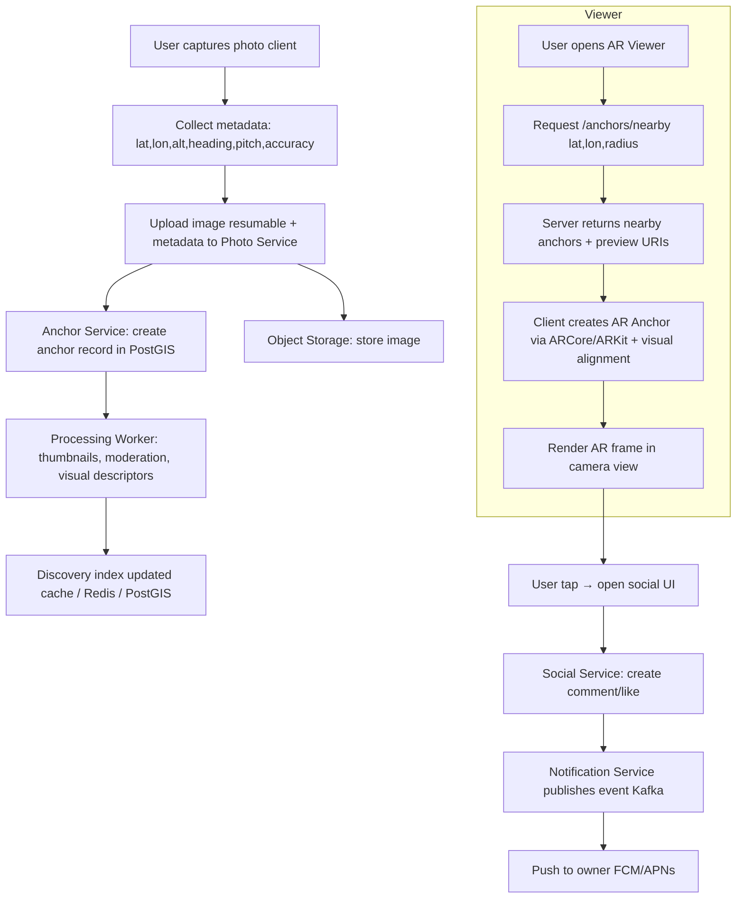
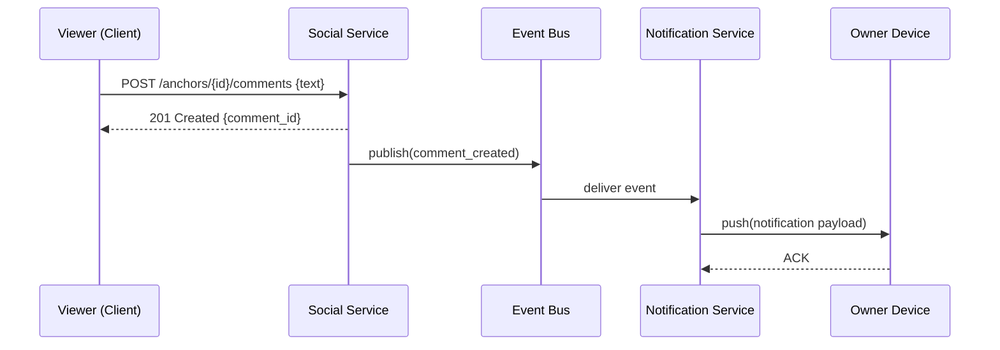

# Detailed low-level architecture — step 1 of N

Below is a precise, implementable low-level architecture for the AR geotagged-photo app. This covers services, data models, API contract examples, AR anchoring workflow, offline & sync behavior, security, scaling, and observability. I’ll keep it focused on actionable design decisions you can hand to engineers.

---

# 1. Deployment topology (cloud + edge)

* **Mobile clients:** Flutter app (iOS & Android). Native platform channels for ARCore / ARKit where necessary.
* **API / App Services:** Containerized microservices (Quarkus / FastAPI / Spring Boot / Node.js) deployed on Kubernetes.
* **Storage:** Object storage (S3/GCS/R2) for images and derived artifacts (thumbnails, optimized images).
* **Primary DB:** PostgreSQL with PostGIS extension (hosted managed or self-managed on k8s).
* **Cache / Search:** Redis for fast lookups & ephemeral geofence sessions; optional vector DB (Milvus/FAISS) only if you add visual similarity features.
* **Message bus:** Kafka (or cloud pub/sub) for notifications, processing pipelines and analytics.
* **Push notifications:** FCM (Android/iOS) / APNs for iOS; consider OneSignal as multi-platform aggregator.
* **Optional VPS / Visual Localization:** If you use Visual Positioning Service, integrate Niantic Lightship or custom VPS service.

---

# 2. Microservice boundaries

1. **Auth Service**

   * JWT issuance, refresh tokens, OAuth integration (Google/Facebook/Apple).
   * User profile & access control.

2. **Photo Service**

   * Handles uploads, thumbnails, image transforms, EXIF extraction.
   * Writes object storage and photo metadata.

3. **Anchor Service**

   * Stores AR anchor definitions (lat, lon, altitude, heading, anchor-id, accuracy, timestamp, device-sensor-hash).
   * Responsible for anchor lifecycle (create, update, delete, visibility).

4. **Discovery Service**

   * Spatial queries (nearby anchors within radius), uses PostGIS.
   * Paging & caching of anchor lists; returns pre-signed image URIs and anchor metadata.

5. **Social Service**

   * Comments, likes, shares, moderation state.
   * Rate-limits, content flags.

6. **Notification Service**

   * Subscribes to events (new comment, new like, anchor viewed) via Kafka.
   * Dispatches push notifications to device tokens.

7. **Processing Worker(s)**

   * Image moderation (ML model), face blur, EXIF normalization, thumbnail generation, reindexing.
   * Stores moderation result & redaction actions.

8. **Admin / Business Service**

   * AR ad placements, merchant tools, billing.

9. **Observability & Ops**

   * Metrics (Prometheus), Traces (OTel), Logs (ELK/Cloud Logging), SLI/SLO, alerting.

Note: services can be grouped initially (MVP: Photo + Anchor + Discovery + Social + Auth + Notification) to reduce scope.

---

# 3. Core data models (essential fields)

## `users`

* `id (UUID)`
* `username`, `display_name`
* `email`
* `auth_provider` (enum)
* `created_at`, `last_active_at`
* `preferences` (json)

## `photos`

* `id (UUID)`
* `owner_id (FK users)`
* `object_uri` (S3 path)
* `thumbnail_uri`
* `captured_at` (timestamp)
* `visibility` (enum: private, friends, public)
* `metadata_id (FK photo_metadata)`
* `created_at`, `deleted_at`

## `photo_metadata`

* `id`
* `photo_id`
* `lat`, `lon` (double)
* `altitude` (double, optional)
* `heading` (double, device yaw)
* `pitch`, `roll` (device orientation)
* `gps_accuracy` (meters)
* `device_model`, `os_version`
* `sensor_hash` (optional fingerprint of local environment)
* `place_name` (reverse-geocoded, optional)
* `exif_json`

## `anchors`

* `id (UUID)`
* `photo_id (FK)`
* `anchor_type` (geo, visual, hybrid)
* `lat`, `lon`, `altitude`, `heading`
* `accuracy_meter`
* `anchor_status` (active, flagged, deleted)
* `anchor_created_at`

## `comments`

* `id`, `anchor_id`, `user_id`, `text`, `created_at`, `edited_at`, `deleted_at`

## `notifications`

* `id`, `user_id`, `type`, `payload (json)`, `read_at`, `created_at`

Add `indexes` on (`lat, lon`) with PostGIS geometry column for efficient radius queries.

---

# 4. API contract (examples)

### POST /v1/photos/upload

Request: multipart/form-data

* file: image
* metadata: JSON {
  lat, lon, altitude, heading, pitch, roll, captured_at, gps_accuracy, visibility
  }
  Response:
* `{ "photo_id": "...", "anchor_id": "...", "thumbnail_uri": "...", "status":"processing" }`

### GET /v1/anchors/nearby?lat={}&lon={}&radius_m={}&limit={}

Response:

* List of anchors with `anchor_id, photo_preview_uri, lat, lon, altitude, heading, distance_m, visibility`

### POST /v1/anchors/{anchor_id}/comments

Body: `{ text }`
Response: 201 created (comment id) and event published to Notification Service.

### WebSocket /v1/stream?token=...

* Real-time events: `comment_created`, `anchor_viewed`, `like_created`

---

# 5. AR anchoring workflow (detailed)

1. **Capture phase (client)**

   * Acquire best-available location via fused provider (GPS + network + WiFi + barometer). Record `gps_accuracy`.
   * Capture device orientation snapshot (heading/pitch/roll) and a small point-cloud or feature fingerprint (optional).
   * Capture image; extract EXIF if present.

2. **Upload phase**

   * Client POSTs image + metadata to `/photos/upload`. For reliability: do background upload with resumable (tus or S3 multipart).
   * Backend responds with `photo_id` and `anchor_id`.

3. **Anchor creation**

   * Anchor Service standardizes coordinates, computes PostGIS geometry, stores anchor with accuracy metadata and TTL for initial stabilization.
   * Processing Worker generates thumbnails, runs moderation, optionally computes visual descriptors (for visual alignment).

4. **Anchoring in AR (viewer)**

   * When user opens AR viewer: client requests `/anchors/nearby` with current coords and device heading + camera FOV.
   * Server returns anchors with estimated screen-projection hints: e.g., offset vector, distance, orientation.
   * Client attempts to place AR anchor using platform API:

     * ARCore/ARKit: create EarthAnchor / LocationAnchor at the provided lat/lon/altitude + set rotation transform using heading.
     * If visual alignment available, run feature matching (client-side) to reduce drift and snap anchor visually to the scene.

5. **Anchoring stabilization**

   * Client collects local pose deltas and, if permitted, can upload refined adjustments (visual anchor transforms) to improve future placements (consensus averaging).

6. **Interaction**

   * User taps anchor → open full-screen photo & social UI. Comments create events published and push sent to owner.

---

# 6. Accuracy & anti-drift strategy

* **Primary anchor coordinates** = GPS + altitude. Use barometer to refine altitude indoors/outdoors when available.
* **Orientation** = fuse magnetometer + gyroscope; capture initial heading at photo time. Store as metadata.
* **Visual fallback** = when GPS accuracy > threshold (e.g., >10 m) or indoors, use Visual Positioning (VPS) or local feature matching to place anchor.
* **Consensus correction** = accept small corrective offsets from later viewer sessions if many clients report the same offset — update anchor transform after consensus (with rate limits & owner approval optionally).
* **User manual adjustment** = provide UI for owner to nudge anchor position after capturing to correct placement.

---

# 7. Offline-first & sync behavior

* **Capture offline:** allow image capture & local anchor creation. Queue uploads & metadata.
* **Local storage:** keep local copy + UUID mapping.
* **Retry policy:** exponential backoff, resumable multipart.
* **Conflict resolution:** last-writer-wins for minor metadata; for visibility/ownership actions require server confirmation.
* **Cache TTL:** cache nearby anchors for a short TTL (30–120s) to allow smooth AR discovery while moving.

---

# 8. Moderation & privacy

* **Automatic moderation pipeline:** Processing Worker runs an image-safety model (NSFW, violence) and face-detection to optionally blur faces based on region laws. Mark entries as `pending` or `rejected`.
* **Report flow:** users can flag anchors/photos; flagged anchors enter review queue.
* **Visibility controls:** private / friends-only / public. Provide owner override & expiration.
* **GDPR / data retention:** provide delete-by-owner, export data endpoints. Store consent & age verification as required.
* **Legal:** allow businesses to opt-in for branded anchors; include terms for public placement.

---

# 9. Security & rate limits

* **Auth:** OAuth + JWT with short TTL & refresh tokens.
* **Rate limiting:** per-user and per-IP for upload, comment, anchor-create endpoints.
* **Signed URLs:** use pre-signed S3 URIs to upload directly from client when possible. Validate metadata signature after upload.
* **Data encryption:** at rest (S3-managed) and in transit (TLS).
* **Access control:** owners can delete/modify their anchors; public anchors readable but mutation restricted.
* **Anti-spam / bot detection:** CAPTCHAs or verification for suspicious mass uploads.

---

# 10. Scalability & cost control

* **Sharding & indexing:** PostGIS with spatial index (GIST) to support location queries. Partition old anchors by time if necessary.
* **CDN:** Serve images via CDN. Use adaptive image sizes and cache headers.
* **Worker autoscale:** scale Processing Workers based on queue length.
* **Data retention tiers:** cold storage for very old/infrequently accessed images to reduce cost.
* **Rate-limited geo queries:** cap `/anchors/nearby` to reduce DB load; use Redis geo for extremely high QPS hot regions.

---

# 11. Observability & SLOs

* **Metrics:** request latencies, 99th-percentile geo query time, worker queue length, anchor creation success rate.
* **Tracing:** trace upload → processing → anchor creation for debugging drift & failures.
* **Logs:** structured logs with anchor_id & user_id.
* **SLO examples:** 95% of `/anchors/nearby` responses < 200ms; image processing queue backlog < threshold.

---

# 12. MVP feature checklist (to deliver quickly)

* Photo capture + local metadata capture (lat, lon, heading, altitude)
* Upload & storage (object store + metadata DB)
* Basic AR viewer that shows anchors within 10–50 m (ARCore/ARKit location anchors)
* Gallery with map clustering & list view
* Public/private visibility toggle
* Comments + push notifications for owner
* Basic moderation (automated NSFW detection + manual reporting)
* Basic admin panel & metrics dashboard

---

--

# AR Geotagged Photo App — Architecture, Schema, Diagrams & Roadmap

Professional, implementable reference covering:

* Flow diagrams (Mermaid)
* Database schema (Postgres + PostGIS DDL)
* Tech stack (frontend, backend, infra, monitoring)
* AR integration details and fallbacks
* Monetization model (implementation notes)
* Feature roadmap (MVP → V2 → V3)

---

## 1. Flow Diagrams (Mermaid)

### 1.1 Anchor lifecycle (Capture → Anchor → View → Interaction)



### 1.2 Comment → Notification sequence



---

## 2. Database Schema (Postgres + PostGIS) — DDL (MVP subset)

```sql
-- Enable PostGIS (example for managed Postgres)
CREATE EXTENSION IF NOT EXISTS postgis;

-- Users
CREATE TABLE users (
  id uuid PRIMARY KEY DEFAULT gen_random_uuid(),
  username text UNIQUE NOT NULL,
  display_name text,
  email text UNIQUE,
  created_at timestamptz DEFAULT now(),
  last_active_at timestamptz
);

-- Photos
CREATE TABLE photos (
  id uuid PRIMARY KEY DEFAULT gen_random_uuid(),
  owner_id uuid REFERENCES users(id) ON DELETE CASCADE,
  object_uri text NOT NULL,
  thumbnail_uri text,
  captured_at timestamptz,
  visibility text NOT NULL DEFAULT 'private', -- enum: private, friends, public
  metadata_id uuid,
  created_at timestamptz DEFAULT now(),
  deleted_at timestamptz
);

-- Photo metadata (geolocation + device sensors)
CREATE TABLE photo_metadata (
  id uuid PRIMARY KEY DEFAULT gen_random_uuid(),
  photo_id uuid REFERENCES photos(id) ON DELETE CASCADE,
  latitude double precision NOT NULL,
  longitude double precision NOT NULL,
  altitude double precision, -- meters
  heading double precision, -- degrees
  pitch double precision,
  roll double precision,
  gps_accuracy double precision,
  device_model text,
  os_version text,
  exif jsonb,
  created_at timestamptz DEFAULT now(),
  geom geometry(PointZ, 4326) -- PostGIS Point with Z for altitude
);

-- Anchors (derived from photo metadata; can be 1:1 or multiple per photo)
CREATE TABLE anchors (
  id uuid PRIMARY KEY DEFAULT gen_random_uuid(),
  photo_id uuid REFERENCES photos(id) ON DELETE CASCADE,
  anchor_type text NOT NULL DEFAULT 'geo', -- geo | visual | hybrid
  lat double precision NOT NULL,
  lon double precision NOT NULL,
  altitude double precision,
  heading double precision,
  accuracy_meter double precision,
  anchor_status text NOT NULL DEFAULT 'active', -- active | flagged | deleted
  created_at timestamptz DEFAULT now(),
  geom geometry(PointZ, 4326)
);

-- spatial index for fast nearby queries
CREATE INDEX idx_anchors_geom ON anchors USING GIST (geom);

-- Comments
CREATE TABLE comments (
  id uuid PRIMARY KEY DEFAULT gen_random_uuid(),
  anchor_id uuid REFERENCES anchors(id) ON DELETE CASCADE,
  user_id uuid REFERENCES users(id) ON DELETE SET NULL,
  text text NOT NULL,
  created_at timestamptz DEFAULT now(),
  edited_at timestamptz,
  deleted_at timestamptz
);

-- Notification tokens
CREATE TABLE notification_tokens (
  id uuid PRIMARY KEY DEFAULT gen_random_uuid(),
  user_id uuid REFERENCES users(id) ON DELETE CASCADE,
  provider text NOT NULL, -- fcm | apns
  token text NOT NULL,
  created_at timestamptz DEFAULT now()
);

-- Simple likes table
CREATE TABLE likes (
  id uuid PRIMARY KEY DEFAULT gen_random_uuid(),
  anchor_id uuid REFERENCES anchors(id) ON DELETE CASCADE,
  user_id uuid REFERENCES users(id) ON DELETE CASCADE,
  created_at timestamptz DEFAULT now(),
  UNIQUE(anchor_id, user_id)
);
```

Notes:

* Use `geom = ST_SetSRID(ST_MakePoint(lon, lat, altitude), 4326)` when inserting.
* Consider `PARTITION BY RANGE (created_at)` for anchors/photos if scale requires.

---

## 3. Tech Stack — Recommended (MVP → Production)

### Frontend (Mobile)

* **Framework:** Flutter (single codebase for iOS & Android)
* **AR:**

  * Android: ARCore (Geospatial API + Earth Anchors)
  * iOS: ARKit (Location Anchors / ARWorldMap where suitable)
  * Optional cross-platform: Niantic Lightship ARDK (VPS + shared anchors)
* **Plugins / Libraries:**

  * `arcore_flutter_plugin` / `arkit_flutter_plugin` (platform channels)
  * `location` / `geolocator` (fused location)
  * `sensors_plus` (compass, gyroscope)
  * `camera` (capture + EXIF)
* **Auth UI:** Firebase Auth SDK (optional) or custom OAuth flow

### Backend

* **Language / Framework:** Quarkus (Java/Kotlin) or FastAPI (Python) or Node.js (Express/Nest) — choose team familiarity. Quarkus recommended for production-grade microservices and small runtime.
* **API style:** REST for core, WebSocket (or MQTT/Socket.IO) for real-time events
* **Message bus:** Kafka (or cloud pub/sub) for decoupled events and notification pipeline
* **DB:** PostgreSQL with PostGIS
* **Cache / Geo-redis:** Redis for short-lived caches and geospatial hotzones
* **Object storage:** S3 / GCS / Cloudflare R2 + CDN (CloudFront / Cloudflare)
* **Image processing:** containerized workers (K8s) or serverless functions for thumbnails + moderation

### Infra & Platform

* **Orchestration:** Kubernetes (EKS/GKE/AKS or self-managed)
* **Ingress & Service Mesh:** Istio (or Linkerd) — Istio if you want advanced traffic management and observability
* **CI/CD:** GitHub Actions / GitLab CI → build → container scan → helm deploy
* **Secrets:** HashiCorp Vault or cloud KMS

### Observability

* **Metrics:** Prometheus
* **Tracing:** OpenTelemetry + Jaeger
* **Logging:** ELK (Elasticsearch + Logstash + Kibana) or cloud logging
* **SLOs & Alerts:** Grafana

### DevOps / Security

* **Policy-as-code:** OPA + Gatekeeper
* **Image scanning:** Trivy / Clair
* **Terraform:** infra provisioning

---

## 4. AR Integration Details & Implementation Notes

### 4.1 Anchor definition & coordinate transforms

* Anchor stores: `{lat, lon, altitude, heading, pitch, roll, accuracy_meter}`
* Use WGS84 (EPSG:4326) for storage; store `geom` with Z for altitude.
* For AR rendering: convert lat/lon/alt to local ENU (east-north-up) coordinates using device location as reference, or rely on platform APIs (ARCore/ARKit) to create Earth/Location anchors.

### 4.2 Platform-specific implementation

* **Android (ARCore Geospatial):**

  * Use EarthAnchor.create(lat, lon, altitude, quaternion) when available.
  * Check `GeospatialPose` for localization state and `horizontalAccuracyMeters`.
* **iOS (ARKit):**

  * Use `ARGeoAnchor` (iOS 14+) or `ARWorldMap` for visual anchors.
  * Fallback to `ARAnchor` with transform if precise geo anchors unavailable.
* **Cross-platform:**

  * Lightship ARDK provides VPS for higher accuracy in urban environments; good for indoor/outdoor mixed scenarios.

### 4.3 Visual localization & drift correction

* **Visual descriptors:** compute lightweight descriptors (ORBs or mobile-friendly embeddings) on the Processing Worker for optional visual alignment.
* **Client-side feature matching:** when GPS poor, match live camera features to stored descriptors and compute local transform.
* **Consensus corrections:** accept anonymized transform corrections from multiple viewers; only apply after threshold (e.g., N unique devices agree) to prevent tampering.

### 4.4 Fallbacks

* **When GPS accuracy < threshold:** show a surface-placed marker (e.g., compass pointer with distance) and allow manual nudge by owner.
* **Indoors:** allow owner to pin using visual anchors (ARWorldMap) and optionally mark as "indoor anchor".

### 4.5 Privacy & Safety

* Allow owner to restrict who can see anchors (friends only, groups).
* Respect local laws: provide face-blur, remove-by-request, and DMCA takedown workflows.

---

## 5. Monetization Model & Implementation Notes

### 5.1 Monetization buckets

1. **Location-based ads (primary)**

   * Businesses buy placements for a geofence region.
   * Ads appear as sponsored AR frames when users view that region.
   * Implement auctioned CPM/CPC or flat-rate placement.

2. **Sponsored Anchors / Boosts**

   * Merchants or creators pay to pin promoted anchors (feature them in discovery lists).

3. **AR Coupon Cards / Deals**

   * Businesses attach coupons/QR codes to anchors; redemptions tracked server-side.

4. **Premium subscriptions**

   * Features: unlimited public anchors, higher storage retention, advanced analytics for merchants.

5. **Creator marketplace**

   * AR sticker packs, custom frames, or pro tools for creators; revenue share.

6. **Direction & Local Commerce (future)**

   * Pay-per-lead when users click "Get directions" to merchant or request a quote.

### 5.2 Implementation considerations

* **Business onboarding:** merchant dashboard, geofence management, billing integration (Stripe).
* **Ad serving:** ad service prioritizes anchors by proximity, engagement, and merchant bid; use server-side bidding & cache hotspots.
* **Fraud prevention:** limit per-merchant anchor density; require proof of ownership (business verification).
* **Analytics:** merchant access to impressions, clicks, redemptions, and map heatmaps.

---

## 6. Feature Roadmap (MVP → V2 → V3)

### MVP (0.5 — core, deliver in 8–12 weeks for an experienced squad)

* Photo capture + metadata capture (lat, lon, heading, altitude)
* Upload pipeline (resumable uploads, object storage)
* Anchor creation & PostGIS storage
* AR viewer: show nearby anchors within 10–50 m using ARCore/ARKit geospatial anchors
* Gallery + map clustering of user's photos
* Public/private visibility toggle
* Commenting + push notifications to owner
* Basic moderation: automated NSFW flagging + manual reporting
* Admin panel + basic metrics

### V2 (improve UX, scale, monetization — 3–6 months)

* Visual localization (VPS) support + consensus correction
* Business onboarding + merchant dashboard
* Sponsored anchors & basic ad placements
* Rich AR interactions (animations, stickers, 2D/3D frames)
* Friends & privacy groups
* Offline capture + reliable background sync
* Enhanced moderation (human-in-loop review queue)

### V3 (growth, platform, creator economy — 6–12 months+)

* Creator marketplace (paid frames, AR experiences)
* Advanced ad auctioning & targeting
* Analytics & heatmaps for merchants
* Multi-user shared AR sessions (real-time shared anchors)
* AR-based gamification (treasure hunts, events)
* Internationalization, localization, and legal compliance for major markets

---

## 7. Operational & Go-to-Market Notes

* **Pilot launch:** target a contained geography (a city, tourist park, or university campus) to validate map anchors and merchant interest.
* **Partner with local businesses/tourism boards** for sponsored anchors and early monetization.
* **Focus on AR stability:** initial retention will depend on AR accuracy and reliability.
* **Privacy-first onboarding:** make visibility controls obvious at capture time and emphasize deletion/export rights.

---


# OpenAPI v3 (MVP) + Flutter sample: Capture metadata & AR anchor

This document contains two artifacts you requested:

1. **OpenAPI v3 spec (YAML)** for the MVP endpoints: photo upload, anchors discovery, comments, notification token register, and auth stubs.
2. **Flutter sample (Dart)** showing: camera capture, metadata collection (GPS, altitude, heading), EXIF extraction, multipart upload to the OpenAPI endpoints, and a minimal ARCore integration sketch (method-channel) for creating an Earth anchor on Android.

---

## Part A — OpenAPI v3 spec (MVP)

```yaml
openapi: 3.0.3
info:
  title: AR Geo-Anchor Photo API
  version: 0.1.0
  description: Minimal API for AR geotagged photo MVP
servers:
  - url: https://api.example.com/v1
    description: Production
  - url: https://staging-api.example.com/v1
    description: Staging
components:
  securitySchemes:
    BearerAuth:
      type: http
      scheme: bearer
      bearerFormat: JWT
  schemas:
    PhotoUploadMetadata:
      type: object
      required: [latitude, longitude, captured_at]
      properties:
        latitude:
          type: number
          format: double
        longitude:
          type: number
          format: double
        altitude:
          type: number
          format: double
        heading:
          type: number
        pitch:
          type: number
        roll:
          type: number
        gps_accuracy:
          type: number
        captured_at:
          type: string
          format: date-time
        visibility:
          type: string
          enum: [private, friends, public]
    PhotoUploadResponse:
      type: object
      properties:
        photo_id:
          type: string
        anchor_id:
          type: string
        thumbnail_uri:
          type: string
        status:
          type: string
    AnchorSummary:
      type: object
      properties:
        anchor_id:
          type: string
        photo_preview_uri:
          type: string
        lat:
          type: number
        lon:
          type: number
        altitude:
          type: number
        heading:
          type: number
        distance_m:
          type: number
        visibility:
          type: string
    CommentCreate:
      type: object
      required: [text]
      properties:
        text:
          type: string
    CommentResponse:
      type: object
      properties:
        comment_id:
          type: string
        anchor_id:
          type: string
        user_id:
          type: string
        text:
          type: string
        created_at:
          type: string
          format: date-time
    NotificationToken:
      type: object
      required: [provider, token]
      properties:
        provider:
          type: string
          enum: [fcm, apns]
        token:
          type: string
paths:
  /photos/upload:
    post:
      summary: Upload photo with geolocation metadata
      security:
        - BearerAuth: []
      requestBody:
        content:
          multipart/form-data:
            schema:
              type: object
              required: [file, metadata]
              properties:
                file:
                  type: string
                  format: binary
                metadata:
                  type: string
                  description: JSON-encoded PhotoUploadMetadata
      responses:
        '201':
          description: Photo uploaded and anchor created
          content:
            application/json:
              schema:
                $ref: '#/components/schemas/PhotoUploadResponse'
        '400':
          description: Bad request
  /anchors/nearby:
    get:
      summary: Get nearby anchors
      security:
        - BearerAuth: []
      parameters:
        - in: query
          name: lat
          required: true
          schema:
            type: number
            format: double
        - in: query
          name: lon
          required: true
          schema:
            type: number
            format: double
        - in: query
          name: radius_m
          required: false
          schema:
            type: integer
            default: 50
        - in: query
          name: limit
          required: false
          schema:
            type: integer
            default: 50
      responses:
        '200':
          description: List of anchors
          content:
            application/json:
              schema:
                type: array
                items:
                  $ref: '#/components/schemas/AnchorSummary'
  /anchors/{anchor_id}/comments:
    post:
      summary: Create a comment for an anchor
      security:
        - BearerAuth: []
      parameters:
        - in: path
          name: anchor_id
          required: true
          schema:
            type: string
      requestBody:
        content:
          application/json:
            schema:
              $ref: '#/components/schemas/CommentCreate'
      responses:
        '201':
          description: Comment created
          content:
            application/json:
              schema:
                $ref: '#/components/schemas/CommentResponse'
  /users/{user_id}/notifications/register:
    post:
      summary: Register device token for push notifications
      security:
        - BearerAuth: []
      parameters:
        - in: path
          name: user_id
          required: true
          schema:
            type: string
      requestBody:
        content:
          application/json:
            schema:
              $ref: '#/components/schemas/NotificationToken'
      responses:
        '200':
          description: Registered
  /auth/login:
    post:
      summary: Mock login endpoint (MVP uses OAuth or Firebase in production)
      requestBody:
        content:
          application/json:
            schema:
              type: object
              properties:
                provider:
                  type: string
                token:
                  type: string
      responses:
        '200':
          description: Returns JWT token
          content:
            application/json:
              schema:
                type: object
                properties:
                  access_token:
                    type: string
                  refresh_token:
                    type: string
```

---

## Part B — Flutter sample (Dart)

This sample focuses on **capture → metadata collect → upload** and a minimal sketch for calling a native method channel to create an Earth anchor in Android (ARCore). It assumes you wire the native Android implementation that receives the anchor request and calls ARCore Geospatial EarthAnchor APIs.

### pubspec dependencies (minimal)

```yaml
dependencies:
  flutter:
    sdk: flutter
  http: ^0.13.5
  camera: ^0.10.0+1
  path_provider: ^2.0.11
  geolocator: ^9.0.2
  sensors_plus: ^2.2.0
  exif: ^2.0.0
  flutter_image_compress: ^1.1.0
```

### Dart: capture, metadata, upload

```dart
import 'dart:convert';
import 'dart:io';
import 'package:flutter/material.dart';
import 'package:camera/camera.dart';
import 'package:geolocator/geolocator.dart';
import 'package:sensors_plus/sensors_plus.dart';
import 'package:http/http.dart' as http;
import 'package:path_provider/path_provider.dart';
import 'package:exif/exif.dart';
import 'package:flutter/services.dart';

class CaptureScreen extends StatefulWidget {
  @override
  _CaptureScreenState createState() => _CaptureScreenState();
}

class _CaptureScreenState extends State<CaptureScreen> {
  CameraController? _controller;
  List<CameraDescription>? cameras;
  double? _heading; // degrees

  static const platform = MethodChannel('tech.kayys.ar/anchor');

  @override
  void initState() {
    super.initState();
    _initCameras();
    // Listen to magnetometer/compass updates (approximate heading)
    sensorsPlusMagnetometer();
  }

  Future<void> _initCameras() async {
    cameras = await availableCameras();
    _controller = CameraController(cameras!.first, ResolutionPreset.high);
    await _controller!.initialize();
    if (mounted) setState(() {});
  }

  void sensorsPlusMagnetometer() {
    // sensors_plus doesn't provide heading directly; you'd compute from magnetometer+accelerometer fusion.
    // For MVP, you can use Geolocator.getCurrentPosition().heading or device sensors combined.
    // This is a placeholder showing subscription example.
    magnetometerEvents.listen((MagnetometerEvent event) {
      // placeholder: compute heading if you fuse accelerometer + magnetometer.
      // For now we'll ignore and get bearing from Geolocator.getCurrentPosition().
    });
  }

  Future<Map<String, dynamic>> _collectLocationAndSensors() async {
    bool serviceEnabled = await Geolocator.isLocationServiceEnabled();
    if (!serviceEnabled) throw Exception('Location services disabled');

    LocationPermission permission = await Geolocator.checkPermission();
    if (permission == LocationPermission.denied) {
      permission = await Geolocator.requestPermission();
      if (permission == LocationPermission.denied) {
        throw Exception('Location permission denied');
      }
    }
    if (permission == LocationPermission.deniedForever) {
      throw Exception('Location permission permanently denied');
    }

    Position pos = await Geolocator.getCurrentPosition(desiredAccuracy: LocationAccuracy.best);
    double? heading = pos.heading; // may be 0 or NaN depending on provider

    // altitude available in Position.altitude
    return {
      'latitude': pos.latitude,
      'longitude': pos.longitude,
      'altitude': pos.altitude,
      'gps_accuracy': pos.accuracy,
      'heading': heading,
      'captured_at': DateTime.now().toUtc().toIso8601String(),
    };
  }

  Future<void> _takePhotoAndUpload() async {
    if (_controller == null || !_controller!.value.isInitialized) return;
    try {
      final XFile file = await _controller!.takePicture();
      final loc = await _collectLocationAndSensors();

      // Extract EXIF (optional)
      final bytes = await file.readAsBytes();
      final tags = await readExifFromBytes(bytes);
      final exifJson = <String, dynamic>{};
      tags.forEach((k, v) => exifJson[k] = v.toString());

      // Optionally compress image before upload
      final tempDir = await getTemporaryDirectory();
      final compressedPath = '${tempDir.path}/${DateTime.now().millisecondsSinceEpoch}.jpg';
      final compressedFile = File(compressedPath)..writeAsBytesSync(bytes);

      // Build metadata
      final metadata = {
        'latitude': loc['latitude'],
        'longitude': loc['longitude'],
        'altitude': loc['altitude'],
        'heading': loc['heading'],
        'gps_accuracy': loc['gps_accuracy'],
        'captured_at': loc['captured_at'],
        'visibility': 'public',
        'exif': exifJson,
      };

      // Upload multipart/form-data
      final uri = Uri.parse('https://staging-api.example.com/v1/photos/upload');
      final request = http.MultipartRequest('POST', uri);
      request.headers['Authorization'] = 'Bearer This_JWT_TOKEN';
      request.files.add(await http.MultipartFile.fromPath('file', compressedFile.path));
      request.fields['metadata'] = jsonEncode(metadata);

      final streamed = await request.send();
      final resp = await http.Response.fromStream(streamed);
      if (resp.statusCode == 201 || resp.statusCode == 200) {
        final body = jsonDecode(resp.body);
        final anchorId = body['anchor_id'];
        // After successful upload, optionally ask native AR (Android) to create an EarthAnchor so it appears in local AR session
        await _createNativeAnchor(anchorId, metadata);
      } else {
        throw Exception('Upload failed: ${resp.statusCode} ${resp.body}');
      }

    } catch (e) {
      print('Error capturing/uploading: $e');
    }
  }

  Future<void> _createNativeAnchor(String anchorId, Map<String, dynamic> metadata) async {
    try {
      final result = await platform.invokeMethod('createEarthAnchor', {
        'anchorId': anchorId,
        'lat': metadata['latitude'],
        'lon': metadata['longitude'],
        'altitude': metadata['altitude'],
        'heading': metadata['heading'] ?? 0
      });
      print('Native anchor created: $result');
    } on PlatformException catch (e) {
      print('Failed to create native anchor: ${e.message}');
    }
  }

  @override
  void dispose() {
    _controller?.dispose();
    super.dispose();
  }

  @override
  Widget build(BuildContext context) {
    if (_controller == null || !_controller!.value.isInitialized) return Container();
    return Scaffold(
      appBar: AppBar(title: Text('Capture')),
      body: Stack(
        children: [
          CameraPreview(_controller!),
          Positioned(
            bottom: 40,
            left: 0,
            right: 0,
            child: Center(
              child: FloatingActionButton(
                onPressed: _takePhotoAndUpload,
                child: Icon(Icons.camera_alt),
              ),
            ),
          )
        ],
      ),
    );
  }
}
```

### Native Android (Kotlin) — MethodChannel handler sketch (ARCore EarthAnchor)

> Note: This is a minimal sketch. For ARCore Geospatial EarthAnchor you need ARCore SDK and proper session management. The code below shows how to receive the method channel call and should be implemented in This `MainActivity` or dedicated AR `Activity`.

```kotlin
// MainActivity.kt (Kotlin)
import io.flutter.embedding.android.FlutterActivity
import io.flutter.embedding.engine.FlutterEngine
import io.flutter.plugin.common.MethodChannel

class MainActivity: FlutterActivity() {
  private val CHANNEL = "tech.kayys.ar/anchor"

  override fun configureFlutterEngine(flutterEngine: FlutterEngine) {
    super.configureFlutterEngine(flutterEngine)

    MethodChannel(flutterEngine.dartExecutor.binaryMessenger, CHANNEL).setMethodCallHandler { call, result ->
      when (call.method) {
        "createEarthAnchor" -> {
          val anchorId = call.argument<String>("anchorId")
          val lat = call.argument<Double>("lat")
          val lon = call.argument<Double>("lon")
          val altitude = call.argument<Double>("altitude")
          val heading = call.argument<Double>("heading")

          // TODO: implement ARCore EarthAnchor creation using ARCore Geospatial API
          // This requires an AR session with Geospatial Mode enabled and handling of
          // localization state (GeospatialPose). Example (pseudocode):
          // if (earth.getTrackingState() == TrackingState.TRACKING) {
          //   val earthAnchor = earth.createAnchor(lat, lon, altitude, Quaternion.fromHeading(heading))
          // }

          // For now we'll return a placeholder success
          result.success(mapOf("status" to "queued", "anchorId" to anchorId))
        }
        else -> result.notImplemented()
      }
    }
  }
}
```

**Implementation notes for native ARCore EarthAnchor:**

* Use the ARCore `GeospatialApi` or `Session` with `Earth` to create `EarthAnchor` (Android). See ARCore Geospatial docs for correct lifecycle & permissions.
* The app must have Google Play services for AR installed and use `ArCoreApk.getInstance().requestInstall()` as needed.
* Handle `GeospatialPose` states: avoid creating anchors until localization (`GeospatialPose.getGeodeticAccuracy` acceptable).

---

